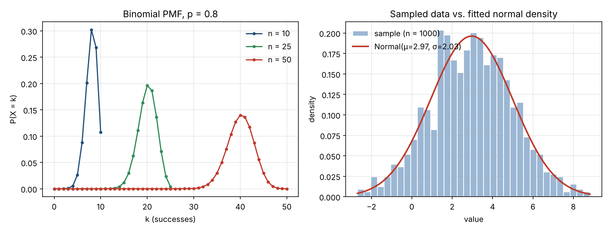

# Binomial PMFs and Sampled Data

This repository explores an Octave text-format workspace named
[`simpson_data.mat`](data/simpson_data.mat). It contains binomial probability
mass functions (PMFs) for three trial counts and a separate 1,000-value
sample. The Python script in this project loads the workspace, checks the
stored PMFs against SciPy, summarizes the sample, and recreates the figure
below.

The filename refers to Simpson's rule, but the original integration script
and the sample-generation procedure are not included. The analysis here is
limited to what can be verified from the variables in the workspace.

## Results at a glance

- The stored PMFs are for binomial random variables with success probability
  `p = 0.8` and trial counts `n = 10`, `25`, and `50`.
- Each stored PMF matches `scipy.stats.binom.pmf` and has total probability
  1 (within floating-point tolerance).
- The separate sample contains 1,000 values, with mean `2.965`, sample
  standard deviation `2.033`, and observed range approximately `[-2.69, 8.83]`.
- Its skewness is approximately `0.00`, its excess kurtosis is approximately
  `-0.18`, and the D'Agostino normality test returns `p = 0.51`. These
  statistics are consistent with a sample roughly resembling a normal
  distribution centered near 3 with standard deviation near 2; they do not
  establish how the values were generated or prove that the underlying
  distribution is normal.

## Visual overview

The left panel compares the three binomial PMFs. The right panel shows the
sample histogram and a normal density fitted using the sample mean and
standard deviation.



The image is generated by `explore_simpson_data.py` and saved to
[`figures/binomial_and_sample.png`](figures/binomial_and_sample.png).

## Getting started

### Requirements

- Python 3.10 or later
- The Python packages listed in [`requirements.txt`](requirements.txt):
  NumPy, SciPy, Matplotlib, and pytest

### Install and run

Clone the repository, create an isolated Python environment, install the
dependencies, run the tests, and then run the analysis:

```bash
git clone https://github.com/Stephen-Austine/Binomial-pmf-and-sampling.git
cd Binomial-pmf-and-sampling

python -m venv .venv
```

Activate the environment:

```bash
# macOS / Linux
source .venv/bin/activate

# Windows PowerShell
.venv\Scripts\Activate.ps1
```

Install dependencies and run the checks:

```bash
python -m pip install -r requirements.txt
python -m pytest
python explore_simpson_data.py
```

Running the script prints the PMF comparisons and sample statistics to the
terminal, then writes a fresh copy of the figure under `figures/`.

## Data in the workspace

The workspace contains the following variables:

| Variable | Shape or type | Description |
| --- | --- | --- |
| `n1`, `n2`, `n3` | Scalars | Binomial trial counts: `10`, `25`, and `50` |
| `p` | Scalar | Binomial success probability: `0.8` |
| `x1`, `x2`, `x3` | 1-D ranges | Possible success counts from `0` through the corresponding `n` |
| `y1`, `y2`, `y3` | Row vectors | PMF values `P(X = k)` for `X ~ Binomial(n, p)` |
| `data` | `1000 x 1` matrix | The separate sample analyzed in the histogram |

For each trial count, `y` stores the binomial probabilities corresponding to
the values in `x`. The script compares those values to SciPy's binomial PMF
and reports whether they match.

The `data` vector is analyzed independently of the binomial variables. Its
observed summary is approximately:

| Statistic | Value |
| --- | ---: |
| Number of observations | 1,000 |
| Mean | 2.965 |
| Sample standard deviation | 2.033 |
| Minimum | -2.69 |
| Maximum | 8.83 |
| Skewness | 0.00 |
| Excess kurtosis | -0.18 |
| D'Agostino normality-test p-value | 0.51 |

The normality-test result is not proof of normality. In addition, the workspace
does not document the sample's source, generation method, or relationship to
Simpson's rule.

## Loading the data in Python

`octave_text.py` provides a small reader for the Octave **text save format**
used by this particular `.mat` file:

```python
from octave_text import load_octave_text

workspace = load_octave_text("data/simpson_data.mat")

sample = workspace["data"]
print(sample.shape)  # (1000, 1)

n = int(workspace["n1"])
p = workspace["p"]
print(f"First PMF: Binomial(n={n}, p={p})")
```

This is not a general MATLAB or `.mat` reader. It supports the Octave text
variable types present in the supplied workspace (`matrix`, `scalar`, and
`double_range`) and raises `ValueError` for unsupported types. In Octave, the
file can be loaded with:

```octave
workspace = load("data/simpson_data.mat");
```

## Project layout

```text
.
├── data/
│   └── simpson_data.mat         # Octave text-format workspace
├── figures/
│   └── binomial_and_sample.png  # Generated PMF and sample visualization
├── tests/
│   └── test_simpson_data.py     # Data and PMF checks
├── explore_simpson_data.py      # Analysis, summary, and plotting script
├── octave_text.py               # Reader for the workspace's Octave text format
├── pyproject.toml               # pytest and Ruff configuration
└── requirements.txt             # Runtime and test dependencies
```

## Tests and continuous integration

The tests check the workspace values and dimensions, confirm that all three
stored PMFs match SciPy and sum to 1, and verify the sample's mean and standard
deviation. They also check that the reader rejects unsupported variable
types. Run them with:

```bash
python -m pytest
```

GitHub Actions runs Ruff, pytest, and the analysis script on Python 3.10 and
3.12 for pushes to `main` and pull requests.

## License

This project is released under the [MIT License](LICENSE).
